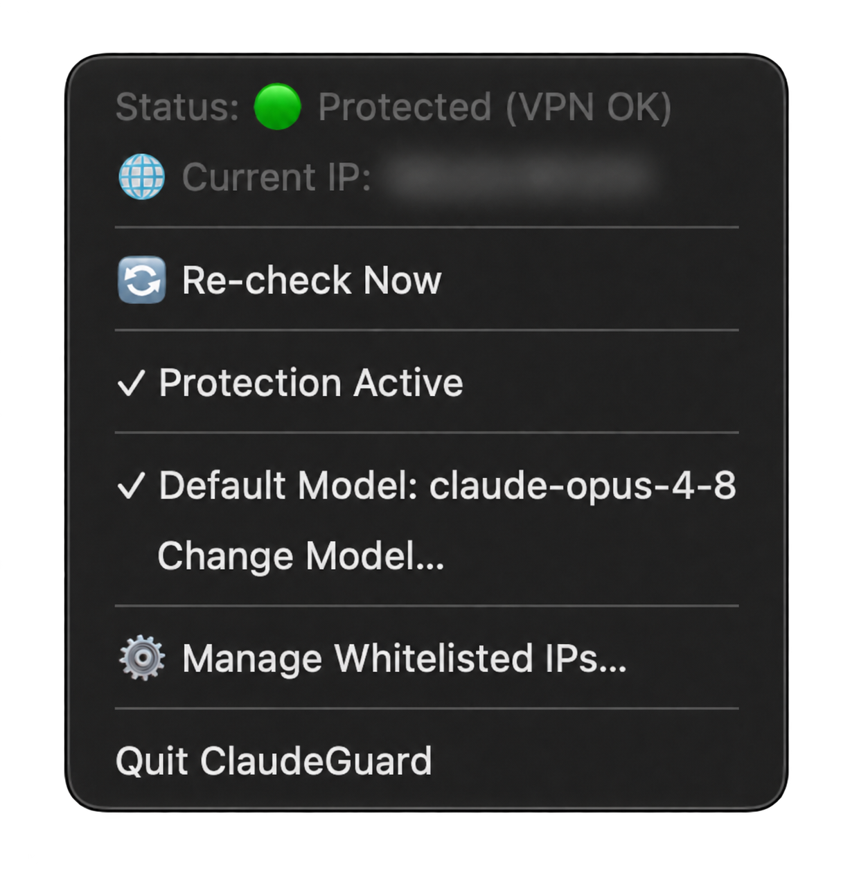
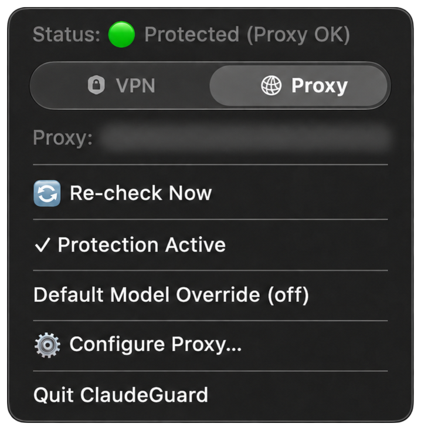

<div align="center">

# 🛡️ ClaudeGuard

**VPN whitelist and proxy routing for Claude on macOS.**

Protect Claude Code CLI, Claude Desktop and known Claude/Anthropic destinations using a verified VPN IP or your own proxy.

**English** · [Русский](README.ru.md)




IP addresses and proxy endpoints in these screenshots are redacted.

</div>

## Features

- **VPN mode:** an IPv4/IPv6 address or CIDR whitelist; the network guard verifies the VPN route and IPv4 exit before allowing protected destinations through that tunnel. IPv6 has no separate VPN verification and stays blocked for protected destinations.
- **Proxy mode:** HTTP/HTTPS, SOCKS4/4a/5, Shadowsocks, VMess, VLESS/Reality, Trojan, Hysteria2 and TUIC through sing-box. Advanced protocols and transports use an outbound JSON profile.
- **Menu bar controls:** live status, VPN/Proxy selector, protection toggle, whitelist and proxy settings. The shield appears at startup; mode switching has no trackpad haptic feedback.
- **Native settings windows:** copy/paste, current proxy prefilled and selected, and profile removal by saving an empty field. An empty whitelist or missing proxy profile blocks access in the selected mode.
- **Claude Code integration:** launch checks, monitoring of running sessions and an optional default `--model` override.
- **Login startup and hook repair:** the daemon periodically checks Claude CLI/Desktop hooks. `doctor` checks and repairs them on demand.

## Install

### PKG

1. Download `ClaudeGuard.pkg` from [Releases](https://github.com/ivblz/ClaudeGuard/releases), open it and follow the installer.
2. Use the account that will run ClaudeGuard; installation requires administrator privileges.
3. Find the shield in the menu bar and choose a mode:
   - **VPN:** connect to your VPN and add its public IP through **Manage Whitelisted IPs…**. Do not whitelist your ordinary connection by mistake.
   - **Proxy:** choose **Configure Proxy…** and save your proxy URL or outbound JSON.

The package targets **macOS 14+**, includes **Apple Silicon and Intel** executables, and bundles **sing-box 1.14.4**. Installing the PKG does not download the engine. **Xcode Command Line Tools are required for `/usr/bin/python3`**; if missing, run `xcode-select --install` and finish that installation first. Existing configuration is preserved on upgrade. A fresh installation starts with an empty whitelist and no proxy profile.

By default the app and helpers are ad hoc signed; the PKG has no Developer ID signature or notarization. macOS may require **System Settings → Privacy & Security → Open Anyway** for a downloaded package you trust.

### Source installation

From a local checkout:

```bash
./install.sh
```

Or download the installer and source from GitHub:

```bash
bash -c "$(curl -fsSL https://raw.githubusercontent.com/ivblz/ClaudeGuard/main/install.sh)"
```

The source installer compiles Swift/C for the current Mac and downloads the SHA-256-pinned engine from GitHub. Internet access and Command Line Tools are required. Administrator privileges are used for the application and network helper. The optional current-IP prompt is for VPN setup only; Proxy can be configured afterward from the menu.

### Build a PKG

```bash
./build.sh
# Optional version override:
./build.sh 2.0.1
```

Output: `ClaudeGuard.pkg` in the project root. The default package version is **2.0.0**. Each build downloads both pinned engine architectures, combines them and includes the engine, licenses and installer scripts in the package. Building does not install the app or change the firewall. See [packaging details](packaging/README.md) for signing and compatibility limits.

### Uninstall

```bash
claudeguard uninstall
# Or, if the manager is unavailable:
bash ~/.local/share/ClaudeGuard/uninstall.sh
```

From a complete checkout, `./uninstall.sh` also works. Uninstallation requires administrator privileges, stops ClaudeGuard services, removes its PF anchor and hosts sections, and removes its CLI hooks. Existing unrelated `claude` commands are preserved. A saved original CLI binary is linked back only if it still exists; Claude itself is not installed or downloaded.

## CLI

| Command | Action |
|---|---|
| `claudeguard status` / `check` | Show status / return exit code 0 if access is allowed, otherwise 1 |
| `claudeguard add-ip <ip-or-cidr>` | Validate and add a whitelist entry |
| `claudeguard remove-ip <entry>` / `list-ips` | Remove an exact entry / list entries |
| `claudeguard set-proxy` | Read one proxy URL or outbound JSON from stdin; empty input removes it |
| `claudeguard use-proxy` / `use-vpn` | Select connection mode |
| `claudeguard enable-protection` / `disable-protection` | Enable / disable protection |
| `claudeguard set-model <model>` | Set and enable the CLI default model override |
| `claudeguard enable-model` / `disable-model` | Enable / disable that override |
| `claudeguard launch-desktop` | Launch Claude Desktop through a preflight check |
| `claudeguard start` / `stop` | Start / stop the menu bar daemon; stopping it is not firewall cleanup |
| `claudeguard doctor` | Check and repair CLI/Desktop hooks |
| `claudeguard install-cli-wrapper` | Repair the CLI hook |
| `claudeguard set-cli-path <path>` | Set the real Claude CLI executable |
| `claudeguard uninstall` | Run the uninstaller |

Use `claudeguard set-proxy` interactively, paste the profile and finish input with Ctrl+D. Do not put real passwords into shell history or committed examples.

## Network protection and limits

The user daemon publishes `allowed`, `blocked`, `offline` or `disabled` in `~/.config/claudeguard/state.json`. Launch checks use this verdict; VPN mode can fall back to its own IP check. ClaudeGuard reacts to macOS network events and also checks the connection every 3 seconds. Processes are terminated after a `blocked` verdict is confirmed; termination is not instantaneous. Already running processes are not terminated solely because the state becomes `offline`.

The root helper manages a private `com.claudeguard` PF anchor and its own PF enable token. It does not globally disable PF or flush every connection. Changes remove connection states for protected destinations. VPN allow rules bind states to the verified `utun` interface. DNS queries for A/AAAA run concurrently with fallback resolvers and a 2.5-second overall deadline; there is no warm DNS cache.

Proxy mode creates a dedicated `utun199` and a local CLI bridge at `127.0.0.1:17943`. It routes known Claude destinations while preserving the system proxy settings and default route. A broader VPN route can carry the upstream connection. Exact route conflicts or an occupied TUN cause an error. Known Claude QUIC traffic is rejected to encourage TCP fallback. Ordinary-user direct traffic to protected IPs is blocked outside the TUN; the normal Proxy rule exempts root traffic for the engine.

VPN mode removes legacy hosts poisoning after PF is installed. On a configured proxy startup failure, the backend attempts a full PF denial before cleaning hosts. Hosts fallback remains when PF fails or the denial path lacks the resolved destination set. Some helper failure paths can reapply that fallback.

**Coverage is limited to known/resolved destinations.** Unknown domains, DNS changes, shared CDNs, ECH and separate browser proxies need additional testing. A browser using another remote proxy can bypass destination routing. Shared-IP blocks can affect unrelated sites. This is not a system-wide Network Extension filter or a guarantee that no request can escape. The private macOS PF ABI and physical Intel compatibility also need testing on each supported environment.

The engine is supervised by launchd. Use **Protection Active** to control protection; quitting or stopping the menu app alone does not remove installed network rules. Model override applies to Claude Code, not the website or Desktop.

## Files, privacy and diagnostics

- App: `/Applications/ClaudeGuard.app`.
- User runtime: `~/.local/share/ClaudeGuard`.
- Configuration: `~/.config/claudeguard/config.json`; proxy credentials are plaintext, not Keychain. The config and private staging files use `0600`; their directories use `0700`.
- Root runtime: `/Library/Application Support/ClaudeGuard`; generated engine configuration contains credentials with `0600` permissions and can remain after stopping the engine.
- Logs: `/tmp/claudeguard.err`, `/tmp/claudeguard-helper.err` and the root-only engine log `/Library/Application Support/ClaudeGuard/proxy.log`.
- Optional timing: set `"trace": true` in the config or `CLAUDEGUARD_TRACE=1` in the relevant process environment. Output: `~/.config/claudeguard/trace.log`. Traces use masked host labels and omit IPs and proxy credentials; tracing is off by default.

## Development

```bash
python3 -B -m unittest discover -s tests
python3 -B tests/check_menu_mode.py
# Optional local engine integration test:
CLAUDEGUARD_TEST_ENGINE=/path/to/sing-box python3 -B -m unittest discover -s tests
```

Unit tests mostly use mocks or temporary files; they do not prove live PF/TUN enforcement. Manual live tests under `tests/` are opt-in and may change the machine; read them before running.

Main components: `src/main.swift` and `ModeSegmentedControl.swift` (UI), `brain.py` (verdict), `config.py`, `ip_checker.py`, `network_guard.py` (staging/DNS), `pf_controller.py` and `pf_anchor.c` (PF), `proxy*.py` (profiles/engine), `integrity.py` (hooks), `cli_wrapper.py`, `app_launcher.py`, and `bin/claudeguard`. Root-owned components must be updated through an installer, not by copying only user-side Python files.

## License

ClaudeGuard uses **GPL-3.0-or-later**; see [LICENSE](LICENSE) and [NOTICE](NOTICE). sing-box **v1.14.4** retains its [upstream license](src/vendor/SING_BOX_LICENSE), including its additional naming/association condition: [source](https://github.com/SagerNet/sing-box/tree/v1.14.4), [source archive](https://github.com/SagerNet/sing-box/archive/refs/tags/v1.14.4.tar.gz). Full license text and notices are included in both installers. Apple PF definitions retain their [Apple Public Source License](src/vendor/APPLE_LICENSE).
