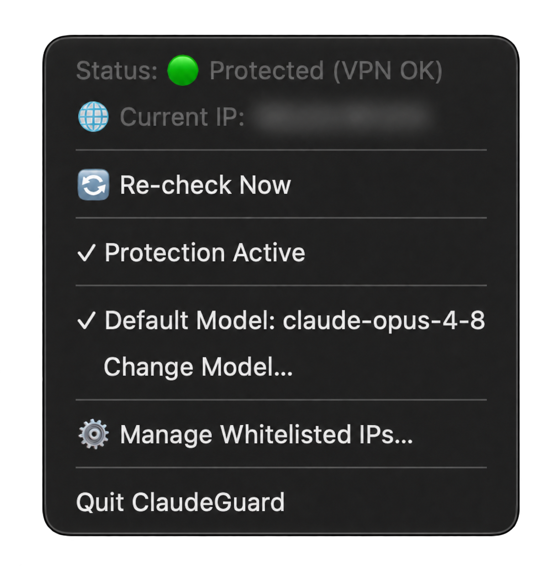
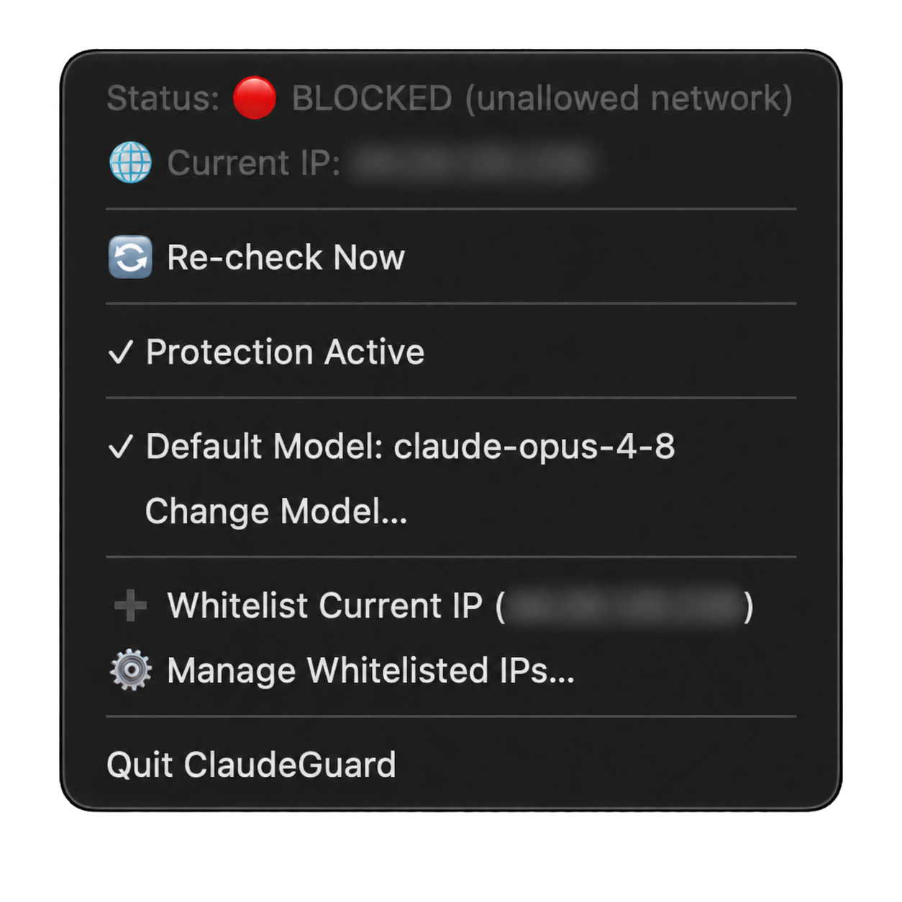
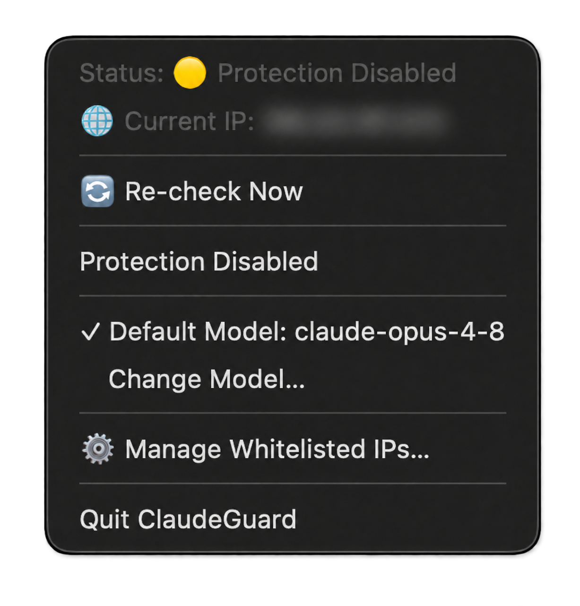
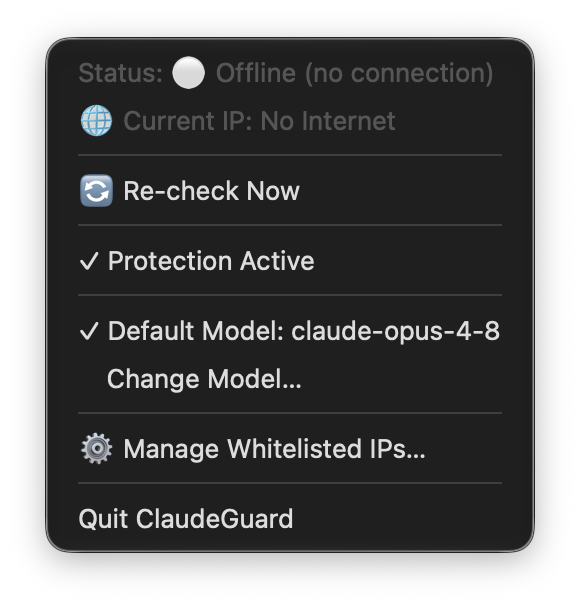

<div align="center">

# 🛡️ ClaudeGuard

**VPN-whitelist защита для Claude на macOS.**

Блокирует приложение **Claude Desktop**, утилиту **Claude Code CLI** (`claude`) и все домены Claude/Anthropic (`claude.ai`, `claude.com`, `anthropic.com` и все их поддомены), если внешний IP устройства не входит в ваш белый список VPN - чтобы вы случайно не зашли в Claude не из того региона.

[English](README.md) · **Русский**

<br>





<br>


</div>

---

## Зачем

Если аккаунт чувствителен к региону, один запрос с не того IP может привести к флагу аккаунта.
ClaudeGuard решает эту проблему: каждый запуск и каждая активная сессия сверяются с белым списком ваших разрешенных IP, и доступ отрубается в момент, когда вы с него слетаете.

## Возможности

- 🔐 **Белый список IP** - Claude открывается **только** при совпадении внешнего IP с вашими VPN-нодами.
- ⏱ **Мгновенный pre-flight** - при запуске `claude` или `Claude.app` внешний IP проверяется за < 0.5с (STUN по UDP). Нет в списке → блок ещё до подключения.
- 🧠 **Единый мозг, один вердикт** - фоновый демон публикует решение в state-файл; CLI, лаунчер и меню-бар читают один и тот же вердикт, поэтому компоненты не расходятся.
- 🚀 **Автозапуск при входе** через `LaunchAgent`.
- 🟢 **Меню-бар** - живой статус (🟢 защищено / 🔴 блок / ⚪ офлайн / 🟡 выкл), тумблеры, whitelist в один клик.
- 🤖 **Модель по умолчанию** - закрепите модель для каждой сессии `claude` (например `claude-opus-4-8`) прямо из меню-бара; обёртка CLI автоматически подставляет `--model`, чтобы не вводить каждый раз руками.

## Установка

### Установщик PKG

1. Скачайте `ClaudeGuard.pkg` из файлов релиза на [GitHub Releases](https://github.com/ivblz/ClaudeGuard/releases) и откройте его.
2. Следуйте шагам установщика и введите пароль администратора при запросе.
3. Подключитесь к VPN, нажмите на щит в строке меню и добавьте IP своего VPN через **Manage Whitelisted IPs…**. При первой установке доступ к Claude заблокирован до добавления разрешённого IP.

Пакет содержит бинарники для Apple Silicon и Intel и требует **macOS 14 или новее**. **Для Python 3 по-прежнему нужны Xcode Command Line Tools**: если их нет, выполните `xcode-select --install` в Терминале, дождитесь завершения и снова откройте установщик. При обновлении существующие настройки сохраняются.

Текущий пакет не подписан и не нотариализован. Если macOS блокирует пакет, которому вы доверяете, разрешите его открытие в **Системные настройки → Конфиденциальность и безопасность → Всё равно открыть**.

### Сборка из исходников

Установщик компилирует нативные бинарники (Swift + C) **прямо на вашей машине**. Собранное локально не имеет
quarantine-флага, поэтому **Gatekeeper ничего не блокирует** - не нужен ни Apple Developer аккаунт, ни подпись,
ни нотаризация, ни Homebrew. Единственное требование - Xcode Command Line Tools (установщик сам предложит
их поставить, если их нет).

Выберите один из двух способов установки из исходников:

**Вариант 1 - одной строкой** (скачает и соберёт с GitHub):

```bash
bash -c "$(curl -fsSL https://raw.githubusercontent.com/ivblz/ClaudeGuard/main/install.sh)"
```

**Вариант 2 - из локальной копии** (склонированное или скачанное репо; GitHub не задействуется):

```bash
./install.sh
```

В обоих случаях скрипт соберёт всё под вашу архитектуру (Apple Silicon или Intel), поставит меню-бар демон в
автозапуск и повесит обёртку на `claude`. Один раз спросит пароль (`sudo` нужен для правки `/etc/hosts` и pf)
и предложит добавить текущий IP в whitelist - соглашайтесь, **только если вы сейчас под своим VPN.**

### Удаление

После установки через PKG:

```bash
bash ~/.local/share/ClaudeGuard/uninstall.sh
```

Из локальной копии исходников:

```bash
./uninstall.sh
```

Приложение устанавливается в `/Applications/ClaudeGuard.app`. Служебные Python-файлы находятся в `~/.local/share/ClaudeGuard`, настройки — в `~/.config/claudeguard`.

## CLI

После установки доступна команда `claudeguard`:

| Команда | Что делает |
|---|---|
| `claudeguard status` | Текущий статус, IP и whitelist |
| `claudeguard add-ip <ip>` | Добавить IP или CIDR в whitelist |
| `claudeguard remove-ip <ip>` | Удалить IP из whitelist |
| `claudeguard list-ips` | Показать whitelist |
| `claudeguard enable-protection` / `disable-protection` | Включить / выключить защиту |
| `claudeguard set-model <model>` | Задать модель по умолчанию (например `claude-opus-4-8`) |
| `claudeguard enable-model` / `disable-model` | Включить / выключить подмену модели |
| `claudeguard launch-desktop` | Запустить Claude Desktop с pre-flight проверкой |
| `claudeguard start` / `stop` | Запустить / остановить меню-бар демон |
| `claudeguard doctor` | Проверить, что все перехваты на месте, и переустановить их |
| `claudeguard set-cli-path <path>` | Указать путь до настоящего `claude`, если автоопределение промахнулось |

### Переустановка Claude нас больше не ломает

Переустановка Claude Code кладёт настоящий бинарник `claude` поверх нашего шима, а
обновление удаляет версионный путь, на который шим передаёт управление, - защита тихо
отваливалась, а в меню-баре всё так же горело 🟢. То же самое с Claude Desktop: его
bundle id и папки автообновления уже переименовывались.

Поэтому ClaudeGuard не хардкодит эти пути, а определяет их сам и переподключает всё,
что отвалилось: демон чинит себя сам **каждые 60 с**, обёртка `claude` перевешивает
шимы при каждом запуске, а `/etc/hosts` переприменяется, если его правит кто-то извне.
Посмотреть состояние всех перехватов (и сразу починить) - `claudeguard doctor`.

## Как это работает

1. **STUN-first детект IP** - внешний IP берётся одним UDP-раундтрипом STUN (десятки мс), с откатом на HTTP-сервисы там, где UDP заблокирован.
2. **Мозг** (`src/brain.py`) превращает IP в один вердикт - `allowed` / `blocked` / `offline` - и работает **fail closed**: пускает только подтверждённый `allowed`.
3. **Единый источник истины** - меню-бар демон пишет вердикт в `~/.config/claudeguard/state.json` на каждой проверке. Обёртка CLI и лаунчер читают его (мгновенно) и делают свою проверку только если демон лёг.
4. **Энфорсмент** - всё семейство доменов Claude/Anthropic (~175 хостов на 5 корневых доменах) блокируется через `/etc/hosts` + правило pf (TCP + UDP/QUIC); приложение force-quit'ится с алертом; активная сессия `claude` убивается в момент, когда IP слетает с whitelist.

> **Область применения:** это защита от *случайной* утечки на своей машине, а не от злонамеренного админа. По-настоящему непробиваемый слой (Network Extension content filter) требует платного Apple Developer аккаунта; здешний on-device подход - бесплатный потолок, и со случайными утечками справляется хорошо.

### Совместимость с другими инструментами, использующими pf

ClaudeGuard хранит правила и таблицу адресов в отдельном anchor `com.claudeguard`.
Включение pf использует собственный token (`-E`); при разблокировке и удалении освобождается
только этот token (`-X`). Глобальные отключение pf и очистка соединений не используются.
Чтобы уже открытые TCP/QUIC-соединения не обходили новый блок, удаляются только состояния
соединений к блокируемым IP. Стандартные домены фильтруются по выделенным диапазонам Anthropic;
добавленные вручную сторонние домены могут указывать на общие IP — их блокировка затронет
все соединения к этим адресам.

Для обновления установленной версии выполните `./install.sh`: одного изменения Python-файлов
недостаточно, поскольку привилегированный backend устанавливается с владельцем root.
Установщик запускает пользовательский демон после установки нового root-хелпера.
Нативный `pf-anchor` точечно добавляет и удаляет только помеченный вызов anchor ClaudeGuard.
Проверка ticket в ядре защищает от одновременного изменения правил другими программами.
Это работает и когда Internet Sharing заменяет стандартный `com.apple/*` своими anchors.
Общий набор правил не перезагружается. Точно распознанные старые правила ClaudeGuard мигрируют;
неоднозначные смешанные старые/чужие правила не переписываются. Совместимость с приватным ABI
macOS проверяется чтением перед изменениями; при несовместимости хелпер сообщает ошибку.

В меню остаются прежние четыре состояния IP/защиты. Ошибки применения записываются в журнал
и передаются проверкам запуска, а демон повторяет попытку — отдельного статуса ошибки нет.
Активный блок также обновляется каждые 60 секунд. При ошибке pf блок в `/etc/hosts` сохраняется.
Подробности: `/tmp/claudeguard.err`, `/tmp/claudeguard-helper.err`.

## Структура проекта

```
src/
  brain.py          Единое ядро решения (читает вердикт демона; STUN-фолбэк)
  ip_checker.py     Детект внешнего IP: STUN по UDP, затем HTTP
  config.py         Конфиг в ~/.config/claudeguard/config.json
  network_guard.py  Подготавливает запросы блокировки hosts/PF для root-хелпера
  integrity.py      Ищет реальные пути Claude; переподключает перехваты после переустановки
  cli_wrapper.py    Pre-flight перехватчик команды `claude`
  app_launcher.py   Pre-flight перехватчик Claude.app
  helper.py         Python-мост для меню-бара: синхронизация сети и восстановление перехватов
  main.swift        Нативный меню-бар демон (AppKit): мониторинг, алерты, state-файл
  hosts_helper.c    Точка входа LaunchDaemon; запускает root-owned Python backend в изолированном режиме
  pf_controller.py  Root-owned backend: отдельный pf anchor, token, подтверждение запросов, слияние hosts
  pf_anchor.c       Точечное добавление/удаление только помеченного вызова нашего anchor
  vendor/
    pf_abi.h        Определения ABI Apple PF для нативного anchor-хелпера
    APPLE_LICENSE   Лицензия извлечённого кода Apple
    README.md       Источники и примечания по ABI
bin/claudeguard     CLI управления
assets/AppIcon.png  Иконка приложения
photos/            Скриншоты для README
install.sh          Компилирует нативно на устройстве и всё ставит
uninstall.sh        Чистое удаление, восстанавливает оригинальный `claude`
README.md           Документация на английском
README.ru.md        Документация на русском
LICENSE             Лицензия проекта
```

## Лицензия

MIT - см. [LICENSE](LICENSE). Определения ABI Apple в `src/vendor/pf_abi.h` сохраняют
уведомления исходного проекта и [Apple Public Source License](src/vendor/APPLE_LICENSE).
